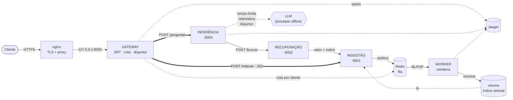
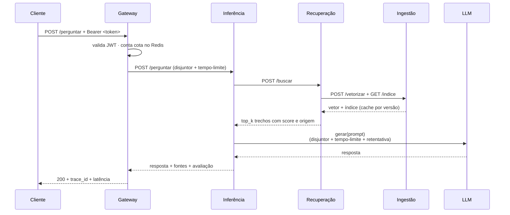

# C3.A2 — Plataforma de IA como Serviço

**Sistemas Distribuídos e Computação em Nuvem · FAESA · 2026/2**
Prof. M.Sc. Howard Cruz Roatti · Aluno: Jordhan ([@jordhanF](https://github.com/jordhanF))

[](https://github.com/jordhanF/sd-2026-2-kit-c3a2/actions/workflows/testes.yml)

### 🌐 No ar em **https://168-75-70-16.sslip.io**

**Credenciais de avaliação:** usuário `avaliador` · senha `avaliacao-c3a2`
Teste direto no navegador em **[/docs](https://168-75-70-16.sslip.io/docs)** — clique em
*Authorize*, cole o token emitido por `POST /login` e dispare qualquer rota.

Um serviço de perguntas e respostas sobre documentos próprios (RAG), publicado como
**plataforma**: sete processos em containers, uma porta de entrada autenticada, fila entre
a escrita e o trabalho pesado, rastreamento que atravessa a fila e HTTPS na borda.

A IA é a **carga de trabalho**, não o objeto: o vetorizador é o TF-IDF do kit e o cliente de
LLM tem modo simulado. O que este repositório tenta fazer bem é a engenharia distribuída em
volta disso.

> Projeto integrador: o núcleo de recuperação e geração vem da minha entrega
> [C2.A2](https://github.com/jordhanF/sd-2026-2-kit-c2a2); o que é novo aqui é o gateway,
> a conteinerização por serviço, o rastreamento distribuído, a segurança e o deploy.
> Este repositório é um **fork do kit do professor** — o primeiro commit do histórico é o
> dele.

---

## A arquitetura



### Os sete processos

| Processo | Papel | Porta |
|---|---|---|
| **nginx** (host) | termina o TLS e é o único que fala com a internet | 443 |
| **gateway** | porta de entrada: autentica, limita, roteia e protege | 8000 (só local) |
| **inferência** | monta o prompt com o contexto e chama o LLM | interna |
| **recuperação** | compara a pergunta com o índice e devolve os trechos | interna |
| **ingestão** | dona do índice e do espaço vetorial; publica na fila | interna |
| **worker** | revetoriza o corpus fora do caminho da requisição | — |
| **redis** | fila de indexação e contador de cota | interna |
| **jaeger** | coletor e interface do rastreamento | 16686 (só local) |

Nenhum serviço interno é alcançável de fora. O compose publica **apenas o gateway**, e só
em `127.0.0.1`; quem atravessa a borda é o nginx.

### O fluxo da pergunta



### O fluxo da indexação (mensageria)

```
POST /indexar ─→ 202 Accepted {"id": "...", "trace_id": "..."}   (não espera indexar)
                      │
                      ├─→ fila 'indexacao' ─→ worker ─→ volume do índice
                      │        (leva o traceparent dentro da tarefa)
GET /tarefa/<id> ─────┘                          └─→ 3 falhas ─→ fila 'descarte'

estados: na_fila → processando → pronto     |     retentando → erro
```

---

## Usar a plataforma publicada

**Pelo navegador**, sem instalar nada: <https://168-75-70-16.sslip.io/docs> abre a
documentação interativa (OpenAPI). Clique em **Authorize**, informe o token obtido em
`POST /login` e dispare qualquer rota ali mesmo. A raiz
(<https://168-75-70-16.sslip.io>) lista as rotas, e `/saude` mostra a plataforma inteira.

**Pelo terminal:**

```bash
API=https://168-75-70-16.sslip.io

# 1. sem token, a porta está fechada
curl -s -o /dev/null -w "%{http_code}\n" -X POST $API/perguntar \
  -H "Content-Type: application/json" -d '{"pergunta":"o que diz o teorema CAP?"}'
# 401

# 2. autenticar (credenciais do avaliador no final desta seção)
TOKEN=$(curl -s -X POST $API/login -H "Content-Type: application/json" \
  -d '{"usuario":"avaliador","senha":"<senha>"}' | python -c "import sys,json;print(json.load(sys.stdin)['token'])")

# 3. perguntar
curl -s -X POST $API/perguntar -H "Authorization: Bearer $TOKEN" \
  -H "Content-Type: application/json" -d '{"pergunta":"o que diz o teorema CAP?"}'

# 4. indexar um documento novo (202: entra na fila)
curl -s -X POST $API/indexar -H "Authorization: Bearer $TOKEN" \
  -H "Content-Type: application/json" \
  -d '[{"texto":"Raft confirma uma operacao quando a maioria registra.","origem":"aula11"}]'

# 5. acompanhar a indexação
curl -s $API/tarefa/<ID> -H "Authorization: Bearer $TOKEN"

# 6. quanto resta da cota (não consome requisição)
curl -s $API/quota -H "Authorization: Bearer $TOKEN"

# 7. saúde da plataforma inteira (pública)
curl -s $API/saude
```

**Credenciais para avaliação:** usuário `avaliador`, senha `avaliacao-c3a2`.

São credenciais de **demonstração**, publicadas de propósito para que a avaliação não
dependa de combinar senha por outro canal. O que as torna aceitáveis aqui: a plataforma não
guarda dado pessoal, o LLM roda em modo simulado (custo zero), a cota de 30 requisições por
minuto limita abuso e a senha é trocável em um comando. No servidor existe apenas o **hash
PBKDF2** dela — nem o repositório nem o servidor guardam a senha em claro.

---

---

## Roteiro de avaliação

Cada item do edital pode ser verificado em poucos minutos, sem instalar nada além de um
navegador.

> **Credenciais de demonstração:** usuário `avaliador`, senha no topo deste README (bloco
> "No ar em"). São credenciais de avaliação, com cota de 30 requisições por minuto; os
> únicos dados da plataforma são os documentos de teste da disciplina.

### 1. A plataforma está no ar? (execução)

Abra <https://168-75-70-16.sslip.io>. A página lista as rotas. O cadeado do navegador
confirma o HTTPS; `http://` redireciona para `https://` com 301.

### 2. Testar tudo pelo navegador (comunicação)

Abra <https://168-75-70-16.sslip.io/docs> — documentação interativa OpenAPI.

| Passo | O que fazer | O que confirma |
|---|---|---|
| a | `POST /perguntar` → **Try it out** → **Execute**, ainda **sem** autorizar | **401** — o gateway fecha a porta |
| b | `POST /login` → Try it out → usuário e senha → Execute | token JWT emitido |
| c | Botão **Authorize** (topo) → cole o token → Authorize | sessão no navegador |
| d | `POST /perguntar` com `{"pergunta":"o que diz o teorema CAP?"}` | resposta **fundamentada**, com `fontes` e `trace_id` |
| e | `POST /indexar` com um documento | **202** e um `id` — entrou na fila, não foi processado na requisição |
| f | `GET /tarefa/{id}` com aquele `id` | `na_fila` → `processando` → `pronto` — a fila andou |
| g | `GET /quota` | quanto resta da cota do seu token |
| h | repita `POST /perguntar` umas 31 vezes | **429** com cabeçalho `Retry-After` — o limite por cliente funciona |
| i | `GET /saude` (não precisa de token) | saúde dos serviços internos e estado dos dois disjuntores |

### 3. Verificação automática de ponta a ponta

Exercita as nove etapas acima em sequência e falha com código diferente de zero se alguma
quebrar:

```bash
git clone https://github.com/jordhanF/sd-2026-2-kit-c3a2.git && cd sd-2026-2-kit-c3a2
pip install requests

API=https://168-75-70-16.sslip.io USUARIO=avaliador SENHA=<senha do topo> \
  python exemplos/fluxo_completo.py
```

Saída esperada:

```
[ok ] rota protegida recusa sem token - HTTP 401
[ok ] saude responde sem token - ok
[ok ] login emite token - HTTP 200
[ok ] senha errada e recusada
[ok ] indexar responde 202 (entra na fila) - HTTP 202
[ok ] worker processou a tarefa - status=pronto
[ok ] pergunta: o que diz o teorema CAP? - 81ms · fontes=['teorema_cap.txt'] · trace=afa96b31...
[ok ] cota e informada - 10/30 usadas

FLUXO COMPLETO OK
```

### 4. Resiliência — ver o disjuntor abrir

Na máquina publicada, derrubando um serviço interno:

```bash
docker compose stop inferencia     # depois: docker compose start inferencia
```

As três primeiras chamadas pagam o tempo-limite (~553 ms cada) e a terceira **abre** o
circuito; da quarta em diante a recusa é imediata (~42 ms) e o corpo do 503 passa a dizer
`disjuntor aberto`. Passada a janela de 20 s com o serviço de volta, uma chamada de teste
fecha o circuito. Os números estão em [Medições](#medições).

### 5. Observabilidade — ver o rastro atravessar a fila

```bash
ssh -L 16686:127.0.0.1:16686 ubuntu@168.75.70.16
# navegador: http://localhost:16686  →  serviço "gateway"  →  um trace de POST /indexar
```

No trace aparecem, sob o **mesmo `trace_id`**: o gateway contando a cota (`INCRBY`), a
ingestão publicando na fila (`RPUSH`) e o **worker** processando — em outro container e
segundos depois. A interface não é pública de propósito; o acesso é por túnel SSH.

### 6. Reprodutibilidade — subir do zero na sua máquina

Os três comandos da seção seguinte. Sem chave de LLM, a plataforma roda offline em modo
simulado. Foi assim que a entrega foi validada: clone limpo numa máquina que nunca tinha
visto o código, um comando, e o verificador do passo 3 passando.

### 7. A suíte

```bash
pip install -r requirements-dev.txt
python -m pytest testes -q          # 82 testes
```

---

## Executar do zero, em um comando

Pré-requisitos: **Docker** e **Docker Compose**. Mais nada — nem Python instalado.

```bash
git clone https://github.com/jordhanF/sd-2026-2-kit-c3a2.git
cd sd-2026-2-kit-c3a2
cp .env.example .env

docker compose up -d --build        # sobe os sete processos
docker compose ps                   # confere

# usar (o .env de exemplo traz usuario aluno / senha troque-esta-senha)
TOKEN=$(curl -s -X POST localhost:8000/login -H "Content-Type: application/json" \
  -d '{"usuario":"aluno","senha":"troque-esta-senha"}' | python -c "import sys,json;print(json.load(sys.stdin)['token'])")

curl -s -X POST localhost:8000/indexar -H "Authorization: Bearer $TOKEN" \
  -H "Content-Type: application/json" \
  -d '[{"texto":"O teorema CAP trata de consistencia e disponibilidade.","origem":"aula10"}]'

curl -s -X POST localhost:8000/perguntar -H "Authorization: Bearer $TOKEN" \
  -H "Content-Type: application/json" -d '{"pergunta":"o que diz o teorema CAP?"}'
```

Sem `LLM_API_KEY` a plataforma funciona **offline**: o cliente de LLM entra em modo simulado
e monta a resposta a partir dos trechos recuperados. Nenhuma chamada sai da máquina.

### A suíte de testes

```bash
pip install -r requirements-dev.txt
python -m pytest testes -q          # 82 testes, sem servidor e sem Redis de pé
```

---

## Observabilidade

Cada requisição vira um **trace** que atravessa os processos. O ponto difícil não é o HTTP —
esse propaga sozinho — é a **fila**: a tarefa fica parada no Redis e quem a consome é outro
processo, depois. Sem tratamento o rastro morreria no gateway e a indexação, que é a parte
cara, ficaria invisível.

A solução está em `comum/tracing.py` + `comum/fila.py`: o `traceparent` do padrão W3C é
injetado **dentro da tarefa** e o worker reabre o span como filho de quem publicou
(`SpanKind.CONSUMER`). O resultado é um trace único cobrindo **gateway → fila → worker**,
que é exatamente o que o edital pede.

```bash
# a interface do Jaeger não é pública; o acesso é por túnel SSH
ssh -L 16686:127.0.0.1:16686 ubuntu@168.75.70.16
# depois, no navegador: http://localhost:16686
```

Toda resposta e **todo erro** carregam o `trace_id`. É o que liga uma reclamação concreta
("deu 503 agora") ao rastro exato, sem caçar por horário no meio de todas as requisições.

---

## Segurança

| Camada | O que foi feito |
|---|---|
| **Transporte** | HTTPS com certificado Let's Encrypt; o nginx redireciona 80 → 443 |
| **Autenticação** | JWT HS256 com `exp` de 1 h, emitido em `/login`; rotas de uso exigem `Bearer` |
| **Senha** | nunca em claro: o ambiente guarda o **hash PBKDF2-SHA256** com sal por senha |
| **Comparação** | `hmac.compare_digest` — comparação que sai no primeiro byte diferente vaza, pelo tempo, quantos bytes estavam certos |
| **Abuso** | cota por cliente e cota separada, por IP, no `/login` (impede varredura de senha) |
| **Superfície** | só o gateway publica porta, e só em `127.0.0.1` |
| **Container** | roda como usuário sem privilégio (uid 10001), não como root |
| **Segredos** | só por variável de ambiente; `.env` fora do repositório; a CI falha se achar segredo embutido |
| **Produção** | com `AMBIENTE=producao` o gateway **se recusa a subir** com o segredo de exemplo |

Uma armadilha que vale registrar: **o Docker escreve direto no `iptables` e passa por cima
do UFW**. Publicar `8001:8001` num servidor com firewall fechado abriria o serviço de
ingestão para a internet inteira sem aviso nenhum. Por isso a interface de publicação é
uma variável (`BIND_LOCAL`), com `127.0.0.1` como padrão.

---

## Conformidade — LGPD

| Dado tratado | Finalidade | Base legal | Retenção |
|---|---|---|---|
| **Usuário e senha** do cliente da API | autenticar quem usa a plataforma | execução de contrato (art. 7º, V) | enquanto a credencial existir; a senha nunca é armazenada, só o hash |
| **Texto das perguntas** | produzir a resposta | execução de contrato | **não é persistido**: vive em memória durante a requisição |
| **Documentos indexados** | formar a base de respostas | fornecido pelo próprio titular | até remoção do volume; é o único dado em disco |
| **Identificador do cliente** (`sub` do token) | aplicar a cota de uso | legítimo interesse (art. 7º, IX) — proteger o serviço | 60 s (a chave do contador expira sozinha) |
| **Logs de requisição** | operar e diagnosticar | legítimo interesse | memória do container, rotacionados pelo Docker |
| **Rastros (traces)** | diagnosticar latência e falha | legítimo interesse | memória do Jaeger; perdidos ao reiniciar |

**O que deliberadamente NÃO é registrado:** o conteúdo das perguntas e das respostas não vai
para o log nem para os atributos dos spans. O log guarda método, rota, status e duração; o
span guarda identificadores e tamanhos. Foi uma decisão, não um acaso — registrar o texto
seria a forma mais fácil de transformar diagnóstico em vazamento, já que uma pergunta pode
conter dado pessoal que o usuário digitou sem pensar.

**Como verificar:**

```bash
docker compose logs gateway | grep -i "teorema\|pergunta" ; echo "(vazio = nenhum texto de pergunta no log)"
```

**Direitos do titular:** eliminação se faz removendo o documento do índice (reindexação do
corpus) e o volume (`docker compose down -v`); como perguntas não são persistidas, não há o
que eliminar delas. Não há compartilhamento com terceiros, exceto a API do LLM quando
`LLM_API_KEY` está configurada — no modo padrão (simulado) **nada sai da máquina**.

---

## Relatório de trade-offs

### CAP — e por que a resposta não é uma só

A plataforma tem **dois estados** com escolhas opostas, de propósito.

**O índice vetorial escolhe consistência (CP).** Reindexar é escrita no índice **inteiro**,
porque o vocabulário do TF-IDF é global. Dois workers escrevendo juntos se sobrescreveriam e
um lote desapareceria sem erro. Por isso há uma **trava de escritor único** no Redis: se a
trava não está disponível, a tarefa volta para a fila — a indexação **para** em vez de
corromper. Diante de uma partição entre worker e Redis, perde-se disponibilidade de escrita.

**A leitura escolhe disponibilidade (AP).** O serviço de recuperação guarda o índice em
cache, invalidado por versão. Se a ingestão oscilar, a leitura continua respondendo com a
última versão conhecida — resposta levemente velha em vez de erro. Para um sistema de
perguntas, responder com um índice de trinta segundos atrás é melhor do que não responder.

**O contador de cota escolhe disponibilidade.** Se o Redis cai, o limite **abre**
(fail-open): perder o teto de uso é menos grave do que recusar todos os clientes porque o
contador caiu. A escolha oposta seria a certa se a cota existisse para proteger custo de
terceiros — por exemplo, uma chave paga de LLM.

**A fila é at-most-once, e isso é uma dívida.** `BLPOP` remove a tarefa antes de processá-la:
worker morto no meio perde aquele lote. `BLMOVE` para uma lista de "em processamento", com
devolução por tempo-limite, daria at-least-once — e, como indexar o mesmo documento duas
vezes é inofensivo (a deduplicação por `(origem, texto)` já existe), seria a escolha certa.
Não entrou por tempo.

### Custo

| Item | Custo mensal |
|---|---|
| VM Oracle Cloud **Always Free** (Ampere A1, 2 OCPU, 11 GiB) | R$ 0,00 |
| Certificado TLS (Let's Encrypt) | R$ 0,00 |
| Domínio (sslip.io resolve o IP embutido no nome) | R$ 0,00 |
| LLM em modo simulado | R$ 0,00 |
| **Total** | **R$ 0,00** |

O custo real da plataforma só aparece quando `LLM_API_KEY` é configurada: aí cada pergunta
vira uma chamada paga, e **a cota por cliente deixa de ser proteção de capacidade e vira
proteção de orçamento** — o que mudaria a decisão do contador de fail-open para fail-closed.

A escolha de VM em vez de PaaS (Render, Railway) também é de custo, só que de outro tipo: o
free tier de PaaS roda **um container por serviço** e hiberna por inatividade. Publicar só o
gateway esvaziaria o item do edital que pede o sistema inteiro subindo com um comando, e o
avaliador que abrisse a URL depois de algumas horas encontraria a aplicação dormindo.

### Latência

| Caminho | Custo |
|---|---|
| `POST /perguntar` | 4 saltos de rede: gateway → inferência → recuperação → ingestão (duas vezes) |
| `POST /indexar` | 1 salto; o trabalho pesado sai do caminho da requisição |
| Falha com o circuito **fechado** | paga o tempo-limite inteiro |
| Falha com o circuito **aberto** | recusa imediata |

Três decisões de desenho atacam latência diretamente:

1. **O 202 na indexação.** O custo de indexar cresce com o tamanho do índice, não com o do
   lote: um documento novo num índice de 800 custa o mesmo que indexar os 800. Isso não cabe
   dentro de um `POST`, então vai para a fila.
2. **Cache do índice por versão.** A recuperação consulta `/indice/versao` (alguns bytes) e
   só baixa o índice inteiro quando ele muda.
3. **O disjuntor.** Quando a dependência está fora, falhar rápido vale mais do que insistir:
   cada falha que paga o tempo-limite inteiro ocupa uma conexão e empilha latência no resto.

O contrapeso: cada salto a mais é latência e um ponto a mais de falha. Um monólito
responderia mais rápido. O que se compra com os saltos é poder escalar o worker sem tocar na
API, trocar o LLM sem mexer na recuperação e falhar em pedaços em vez de inteiro.

---

## Medições

Tudo abaixo foi medido **na plataforma publicada**, pela internet, com HTTPS.

### Latência de uma pergunta (10 chamadas)

| Medida | Valor |
|---|---|
| 1ª chamada | 60 ms |
| Mediana | 61 ms |
| Mais rápida | 59 ms |
| Mais lenta | 63 ms |

São quatro saltos internos (gateway → inferência → recuperação → ingestão, duas vezes) mais
TLS e a travessia da internet, em 60 ms. O índice vem do cache enquanto a versão não muda —
é o que impede que cada pergunta arraste todos os vetores pela rede.

### O que o disjuntor compra (serviço de inferência derrubado em produção)

```
1. HTTP 503 em  556 ms   -> tentou, esperou o tempo-limite e falhou
2. HTTP 503 em  553 ms   -> tentou e falhou
3. HTTP 503 em  553 ms   -> tentou e falhou; o circuito ABRE
4. HTTP 503 em   43 ms   -> recusado na hora, sem tentar
5. HTTP 503 em   42 ms   -> recusado na hora, sem tentar

(serviço religado, passada a janela de 20 s)
   HTTP 200             -> uma chamada de teste passa e o circuito fecha
```

**13× mais rápido para falhar** depois que o circuito abre. Não é cosmético: cada falha que
paga o tempo-limite inteiro segura uma conexão e empilha latência em todo o resto.

### O rastro atravessando a fila

Um trace real da plataforma publicada — **22 spans, 3 serviços, um só `trace_id`**:

```
gateway      POST /indexar                      10.4 ms
gateway      INCRBY                              0.3 ms   <- cota do cliente, no Redis
gateway      EXPIRE                              0.2 ms
gateway      POST                                5.6 ms   <- chamada ao serviço de ingestão
ingestao     POST /indexar                       4.0 ms
ingestao     RPUSH                               0.4 ms   <- tarefa entra na FILA
ingestao     POST /indexar http send             0.7 ms   <- 202 volta ao cliente
...
worker       worker indexar                      7.9 ms   <- OUTRO processo, depois
worker       SET / GET / DEL                     0.2 ms
```

Duas coisas que esse rastro mostra e que um log não mostraria:

1. **O span do worker está dentro do mesmo trace do `POST /indexar`**, embora tenha
   acontecido em outro container, alguns segundos depois. É o `traceparent` viajando dentro
   da tarefa.
2. **A duração total do trace é ~3 s, mas o cliente foi respondido em 10 ms.** A diferença é
   exatamente o tempo que a tarefa passou esperando na fila — o custo que a mensageria
   assume para tirar o trabalho pesado do caminho da requisição.

### Tamanho das imagens

Separar `comum/texto.py` do módulo que importa scikit-learn tirou a biblioteca científica
das imagens que não a usam: **gateway e inferência** instalam só o necessário, enquanto
ingestão, recuperação e worker continuam com o vetorizador.

---

## Decisões de projeto

**Um contador de cota compartilhado, não em memória.** Contador em processo funciona com um
gateway e mente com dois: subindo `--scale gateway=2`, cada réplica concederia a cota inteira
e o limite real viraria o dobro do anunciado. Como o Redis já está lá para a fila, o estado
compartilhado sai de graça — e o gateway continua sem estado, que é o que permite replicá-lo.

**A cota é por dono do token, não por IP.** Vários clientes atrás do mesmo IP (escritório,
celular em NAT) não disputam a mesma cota, e um token não escapa do limite trocando de rede.
No `/login` é o contrário — ali ainda não há cliente identificado, então a cota é por IP.

**Um disjuntor por destino.** Com um contador único, a inferência fora do ar cortaria também
a indexação, que está saudável. Falhas diferentes precisam de contadores diferentes.

**Erro de cliente não vira 503.** Um 404 do serviço interno é resposta legítima, não falha de
infraestrutura: o gateway repassa o status e **não conta como falha no disjuntor**. Tratar
4xx como indisponibilidade abriria o circuito por causa de quem digitou um id errado.

**Retentativa por dentro do disjuntor.** Uma sequência esgotada de tentativas conta como
**uma** falha. Se cada tentativa contasse, o circuito abriria no primeiro soluço de rede.

**Imagens diferentes para serviços diferentes.** Gateway e inferência não instalam
scikit-learn — o `normalizar` que os prendia à biblioteca científica saiu para
`comum/texto.py`. São ~100 MB a menos em cada imagem e menos superfície para atualizar.

**O contexto de build é a raiz do repositório.** A biblioteca `comum/` precisa entrar em
cinco imagens e o Docker não copia de fora do contexto; cada serviço declara
`dockerfile: <servico>/Dockerfile` com `context: .`.

**O índice é montado só em quem precisa do arquivo.** Worker escreve, ingestão lê.
Recuperação, inferência e gateway não tocam o disco — falam HTTP.

---

## Limitações conhecidas

- **A fila é at-most-once** (ver trade-offs): worker morto no meio perde o lote.
- **Reindexação é O(corpus)** a cada lote. Serve para a escala do trabalho; um banco vetorial
  de verdade (FAISS, Qdrant) indexaria incrementalmente.
- **Rastros em memória.** O Jaeger `all-in-one` perde tudo ao reiniciar. Em produção seria
  um coletor com armazenamento persistente e amostragem.
- **Um usuário só.** Não há cadastro, papéis nem revogação de token: o `exp` curto é a única
  revogação. Uma lista de tokens revogados no Redis seria o próximo passo.
- **Sem autoescalonamento automático.** O worker escala à mão (`--scale worker=3`); medir o
  tamanho da fila e ajustar sozinho ficou como extensão não implementada.
- **TF-IDF não entende sinônimo.** Pergunta que não repete nenhuma palavra do documento não
  recupera nada.

---

## O edital, item por item

| Item | Onde está |
|---|---|
| Gateway + inferência + worker + armazenamento vetorial | `gateway/`, `inferencia/`, `worker/`, `ingestao/` |
| Um Dockerfile por serviço | `gateway/Dockerfile` e os outros quatro |
| Compose sobe tudo com um comando | `docker compose up -d --build` |
| Deploy em nuvem free tier com URL pública | https://168-75-70-16.sslip.io (Oracle Always Free) |
| Tempo-limite, retentativa e circuit breaker | `comum/retentativa.py`, `comum/circuit_breaker.py`, `gateway/app.py` |
| Rastreamento cobrindo gateway, fila e worker | `comum/tracing.py` + `comum/fila.py` + `worker/indexador.py` |
| JWT no gateway | `gateway/autenticacao.py` |
| Rate limit | `gateway/limite.py` |
| HTTPS no serviço publicado | `deploy/nginx.conf.exemplo` + Let's Encrypt |
| Seção de conformidade (LGPD) | acima |
| Relatório de trade-offs (CAP, custo, latência) | acima |
| Extensão: CI/CD | `.github/workflows/testes.yml` |

## Estrutura

```
├── gateway/          porta de entrada: JWT, cota, disjuntor, roteamento
│   ├── app.py  autenticacao.py  limite.py  Dockerfile
├── ingestao/         dona do índice e do espaço vetorial
├── recuperacao/      busca por similaridade
├── inferencia/       prompt + LLM + citação de fontes
├── worker/           consumidor da fila de indexação
├── comum/            biblioteca compartilhada pelas cinco imagens
│   ├── tracing.py    rastreamento, inclusive a travessia da fila
│   ├── fila.py       fila, trava de escritor único e descarte
│   ├── repositorio.py  persistência atômica do índice
│   └── ...           ranking, retentativa, disjuntor, avaliação, log
├── exemplos/         fluxo_completo.py: verificação de ponta a ponta
├── testes/           82 testes, offline, sem servidor
├── deploy/           instruções de publicação e vhost do nginx
├── documentos/       base de teste
└── docker-compose.yml
```
